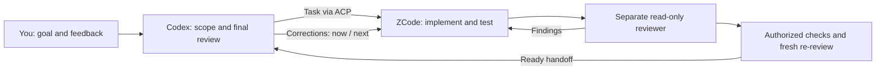

# Codex ZCode Tandem — a Codex + ZCode collaboration skill

**Let Codex coordinate. Let ZCode implement, test and review.**

Codex ZCode Tandem is an open-source **Windows skill that connects OpenAI Codex to native ZCode through ACP (Agent Client Protocol)**. Delegate coding tasks to ZCode using your own **GLM Coding Plan**, follow progress, and send corrections without copying whole conversations between tools. Development tasks go through independent code review, repairs and verification before returning to Codex for final review.

[简体中文](README.zh-CN.md) · [Install](references/installation.md) · [Download the latest release](https://github.com/linxiangpk1991/codex-zcode-tandem/releases/latest) · [Examples](docs/examples.md) · [FAQ](docs/faq.md)


**Windows · Node 24.19.0 · ACP 0.85.3 · MIT license · English / 简体中文**

## When should you use it?

Tandem is for developers who already use Codex and ZCode and want them to work on the same task. It is useful when you want to:

- **Delegate a bounded feature or bug fix.** Codex defines the files, requirements and checks; ZCode does the implementation using your existing Coding Plan.
- **Correct a task while it is running.** Read progress, ask a follow-up question or send a revised requirement to the same ZCode session.
- **Review before handing work back.** A fresh, read-only ZCode session checks the candidate. Findings go back for repair, followed by the authorized checks and another review.
- **Keep a longer task understandable.** Follow saved sessions, native workflow state and structured results when work spans several steps.

For a small edit, staying in Codex may be simpler. Tandem helps when delegation and follow-up are worth keeping track of. There are no measured speed or token-saving claims.

## How do Codex and ZCode work together?

Codex remains the controller: it prepares the task, owns the allowed scope and decides whether the result meets your request. Native ZCode is the coding worker. The local ACP adapter connects their sessions and records progress, questions, corrections and delivery status.



**Independent review is on by default for development tasks.** It uses a fresh native session rather than the developer's own summary. The runner allows up to two repair rounds; unresolved findings or missing verification block a ready handoff. Read-only questions and connection probes skip this loop. [Review and verification details](references/delivery.md)

| During a task | What Tandem does |
| --- | --- |
| Check progress | Reads a local status snapshot without another model call. |
| Change a requirement | Uses native `now` / `next` steering when available; reports queued or delivered state separately from completed work. |
| Ask a follow-up | Sends a separate follow-up turn when the foreground session can process it. |
| Answer ZCode | Validates the pending question ID and its single-choice, multiple-choice or supported form answers. |
| Resume work | Reads saved session and workflow state before continuing; checks workspace identity. |
| Hand over screenshots | Binds image files to the candidate; leaves visual acceptance to a vision-capable controller. |

A delivered correction does not prove that it has been implemented. Running background actors require an explicit workflow amendment or pause/readback/resume. See [live controls](references/live-control.md) and the [1.6 collaboration guide](references/collaboration-upgrade.md).

## Quick start on Windows

You need Codex with skills support, a separately installed and signed-in [ZCode](https://zcode.z.ai/), Git and **Node 24.19.0**. You supply your own ZCode account and model access.

In PowerShell, choose a directory you will keep:

```powershell
git clone https://github.com/linxiangpk1991/codex-zcode-tandem.git
Set-Location codex-zcode-tandem
node.exe --version
npm.cmd ci --prefix runtime --ignore-scripts --no-audit --no-fund
node.exe scripts/setup.mjs
```

The installer creates `~/.agents/skills/codex-zcode-tandem` and points it to this checkout. Keep the checkout in place. For a custom ZCode installation, pass its native entry:

```powershell
node.exe scripts/setup.mjs --zcode-bin 'D:/Apps/ZCode/resources/glm/zcode.cjs'
```

Open a new Codex chat or reload skills, then try a read-only task:

> $codex-zcode-tandem Ask ZCode to inspect this project's input validation. Read only. Identify one reproducible bug and the smallest useful test. Review the evidence before changing code.

For a development task:

> $codex-zcode-tandem Delegate the CSV export date-boundary bug to ZCode. Identify the affected files and existing test command first. Keep the change within that scope, run independent review and repair, and verify it before handing the result back. Do not publish or deploy.

Prefer a ZIP? Use [Releases](https://github.com/linxiangpk1991/codex-zcode-tandem/releases/latest), extract it to a permanent directory, then follow the [installation guide](references/installation.md). It also covers connection checks, authentication, updates and rollback.

## GLM Coding Plan, models and compatibility

Tandem uses your native ZCode account; it does not turn Codex itself into a GLM client. Your selected Codex controller model stays in place. ZCode implementation and review default to **GLM-5.3** with `thought=max`; **GLM-5.3-Flash** is an explicit option for smaller tasks.

The **v1.6.0 tested baseline** is Windows, Node 24.19.0, ACP 0.85.3 and ZCode Desktop 3.18.2.10443 / CLI 0.17.1. Another installed version needs its own connection and task checks. macOS and Linux are not supported by the current launcher.

Desktop authentication is the default. An existing Coding Plan key can be selected explicitly for compatibility. No credentials or subscription are bundled, and there is no automatic paid-provider fallback. [Authentication and setup](references/installation.md)

## What has been verified?

The v1.6.0 public candidate passed **220 Windows CI tests**. The shared runtime also completed real GLM-5.3/max checks covering live correction, independent review, repair, authorized tests and a fresh review, plus structured form answers. The release ZIP was installed in a separate test directory and its published checksum was checked after download.

[v1.6.0 CI result](https://github.com/linxiangpk1991/codex-zcode-tandem/actions/runs/43776107109) · [Verification scope and limitations](references/acceptance.md) · [Release notes](https://github.com/linxiangpk1991/codex-zcode-tandem/releases/tag/v1.6.0)

The adapter runs locally, but ZCode uses its service for inference. Tool permission checks are not an OS sandbox. Pausing does not undo completed writes, and a ready handoff is not production or business acceptance. Screenshots still need visual review; no cross-platform or 90-minute endurance result is claimed.

## Documentation

| Task | English | 简体中文 |
| --- | --- | --- |
| Install or troubleshoot | [Installation](references/installation.md) | [安装与排障](references/installation.zh-CN.md) |
| Try realistic coding tasks | [Examples](docs/examples.md) | [使用场景](docs/examples.zh-CN.md) |
| Understand review and repair | [Default review loop](references/delivery.md) | [默认复审闭环](references/delivery.zh-CN.md) |
| Send corrections and answer forms | [Collaboration guide](references/collaboration-upgrade.md) | [协作指南](references/collaboration-upgrade.zh-CN.md) |
| Control or resume work | [Live controls](references/live-control.md) | [实时控制](references/live-control.zh-CN.md) |
| Use native workflows | [Workflows](references/native-workflows.md) | [原生工作流](references/native-workflows.zh-CN.md) |
| Prepare a task brief | [Task briefs](references/worker-prompts.md) | [委派模板](references/worker-prompts.zh-CN.md) |
| Understand the implementation | [Architecture](references/project-map.md) | [项目结构](references/project-map.zh-CN.md) |
| Find a quick answer | [FAQ](docs/faq.md) | [常见问题](docs/faq.zh-CN.md) |

For assistants reading the repository, [llms.txt](llms.txt) is a documentation index; [SKILL.md](SKILL.md) contains the operating instructions. Version history belongs in the [changelog](CHANGELOG.md).

## Community and license

This is an independent community project, not an official OpenAI or Z.ai integration. The public skill installs as **`codex-zcode-tandem`**, separately from a personal `zcode-native` installation.

Bug reports and documentation corrections are welcome in English or Chinese. See [contributing](CONTRIBUTING.md), [security](SECURITY.md) and the [MIT license](LICENSE). Built on [zcode-acp](https://github.com/william0wang/zcode-acp) and native [ZCode](https://zcode.z.ai/); upstream products retain their own terms. [Artwork credits](assets/README.md)
