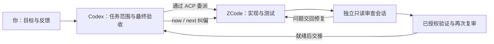

# Codex ZCode Tandem：让 Codex 与 ZCode 协作开发

**Codex 负责统筹，ZCode 负责实现、测试和复审。**

Codex ZCode Tandem 是一个开源的 **Windows Codex 技能，通过 ACP（Agent Client Protocol）连接 OpenAI Codex 与原生 ZCode**。你可以让 Codex 把开发任务交给 ZCode，使用自己的 **GLM Coding Plan** 完成实现，过程中查看进度、追问和补充要求。开发完成后，先经过独立代码审查、修复和验证，再交回 Codex 总控验收。

[English](README.md) · [安装指南](references/installation.zh-CN.md) · [下载最新版本](https://github.com/linxiangpk1991/codex-zcode-tandem/releases/latest) · [使用场景](docs/examples.zh-CN.md) · [常见问题](docs/faq.zh-CN.md)


**Windows · Node 24.19.0 · ACP 0.85.3 · MIT 开源 · 中英文文档**

## 什么情况下适合用？

如果你已经同时使用 Codex 和 ZCode，经常在两边复制需求、补充背景、搬运结果，Tandem 可以把这段协作接起来。它适合这些任务：

- **把一个功能或缺陷交给 ZCode。** Codex 先确定修改范围和验证方法，ZCode 使用已有的 Coding Plan 完成实现。
- **开发中途需要调整要求。** 读取进度、询问卡点，或把新要求发给同一个 ZCode 会话，不必重讲全部背景。
- **交付之前先检查和修复。** 新建只读审查会话检查实际代码，发现问题交回开发会话修复，然后执行约定的检查并再次复审。
- **跟进有多个步骤的任务。** 查看保存的会话、原生工作流状态和结构化结果，了解工作进行到了哪里。

改一行文案，直接让 Codex 改通常更省事。任务值得委派、而且需要持续跟进时，Tandem 更有用。项目没有宣称经过测量的提速或 token 节省比例。

## Codex 和 ZCode 怎么分工？

Codex 是总控，负责理解需求、划定允许修改的范围，并判断结果是否满足要求。原生 ZCode 是执行者。两者通过本地 ACP 适配器连接，进度、问题、纠偏和交付状态都有记录。



**开发任务默认启用独立审查。** 审查使用新会话，不依赖开发者自己的总结。最多进行两轮修复；问题未解决或验证缺失，就不能作为已就绪结果交付。只读提问和连接探针不进入这个闭环。[查看审查与验证机制](references/delivery.zh-CN.md)

| 你想做的事 | Tandem 的处理方式 |
| --- | --- |
| 看进度 | 读取本地状态快照，不额外调用模型。 |
| 修改要求 | 能力可用时使用原生 `now` / `next` 纠偏，分别报告排队、送达和任务完成状态。 |
| 追问细节 | 在前台会话能够处理时执行单独的后续回合。 |
| 回答 ZCode 的问题 | 核对问题标识，提交单选、多选或受支持的表单答案。 |
| 继续未完成任务 | 先读回保存的会话和工作流状态，并检查工作区身份。 |
| 交接界面截图 | 核对图片与候选代码的对应关系，视觉效果交给具备视觉能力的总控验收。 |

消息送达不等于修改已经落实。正在运行的后台角色需要明确修订工作流，或暂停、读回后续接。详见[实时控制](references/live-control.zh-CN.md)与[1.6 协作指南](references/collaboration-upgrade.zh-CN.md)。

## Windows 快速安装

准备好支持技能的 Codex、单独安装并登录的 [ZCode](https://zcode.z.ai/)、Git，以及 **Node 24.19.0**。ZCode 账号和模型权限由你自己提供。

选一个准备长期保留的目录，在 PowerShell 中执行：

```powershell
git clone https://github.com/linxiangpk1991/codex-zcode-tandem.git
Set-Location codex-zcode-tandem
node.exe --version
npm.cmd ci --prefix runtime --ignore-scripts --no-audit --no-fund
node.exe scripts/setup.mjs
```

安装器会在 `~/.agents/skills/codex-zcode-tandem` 创建技能入口，指向这份源码，因此安装后请保留源码目录。如果 ZCode 安装在自定义目录，传入原生入口路径：

```powershell
node.exe scripts/setup.mjs --zcode-bin 'D:/Apps/ZCode/resources/glm/zcode.cjs'
```

打开新的 Codex 聊天或重新加载技能，先试一个只读任务：

> $codex-zcode-tandem 让 ZCode 检查这个项目的输入校验。只读，找出一个可以复现的问题和最小测试方法。先复核证据，再决定是否修改代码。

需要实际开发时，可以这样说：

> $codex-zcode-tandem 把 CSV 导出的日期边界问题交给 ZCode。先确认受影响的文件和已有测试命令，只在约定范围内修改。完成后执行独立复审、修复和验证，再交回结果。不要发布或部署。

也可以从 [Releases](https://github.com/linxiangpk1991/codex-zcode-tandem/releases/latest) 下载 ZIP，解压到长期保留的目录，再按[安装指南](references/installation.zh-CN.md)操作。指南还包含连接检查、认证、更新和回退方法。

## GLM Coding Plan、模型与兼容性

Tandem 使用原生 ZCode 的账号，让 ZCode 承担执行工作；Codex 总控继续使用你选定的模型。ZCode 的核心实现和审查默认使用 **GLM-5.3**、`thought=max`；小任务可明确选择 **GLM-5.3-Flash**。

**v1.6.0 已验证基线**是 Windows、Node 24.19.0、ACP 0.85.3，以及 ZCode 桌面版 3.18.2.10443 / CLI 0.17.1。其他安装版本需要先做连接和实际任务检查。当前启动器不支持 macOS 和 Linux。

默认使用桌面端认证，也可明确选择已有 Coding Plan 密钥的兼容方式。项目不附带账号、密钥或订阅，不会自动切换到付费供应商。[认证与安装说明](references/installation.zh-CN.md)

## 验证到了什么程度？

v1.6.0 公开版候选通过了 **220 项 Windows CI 测试**。共享运行时还完成了真实 GLM-5.3/max 任务验证，覆盖实时纠偏、独立审查、修复、已授权测试和再次复审，以及结构化表单回答。发布 ZIP 已在独立目录安装，并在发布后重新下载核对校验值。

[v1.6.0 CI 结果](https://github.com/linxiangpk1991/codex-zcode-tandem/actions/runs/43776107109) · [验收范围与限制](references/acceptance.zh-CN.md) · [版本说明](https://github.com/linxiangpk1991/codex-zcode-tandem/releases/tag/v1.6.0)

适配器在本地运行，ZCode 的模型推理仍使用服务端。工具权限检查不等于操作系统沙箱；暂停不会撤销已完成的写入，交付就绪也不等于生产或业务验收。截图仍需视觉复核，项目没有宣称跨平台或连续 90 分钟耐久验收。

## 文档导航

| 你想做什么 | 简体中文 | English |
| --- | --- | --- |
| 安装或排查问题 | [安装与排障](references/installation.zh-CN.md) | [Installation](references/installation.md) |
| 尝试实际开发任务 | [使用场景](docs/examples.zh-CN.md) | [Examples](docs/examples.md) |
| 了解审查与修复 | [默认复审闭环](references/delivery.zh-CN.md) | [Default review loop](references/delivery.md) |
| 提交纠偏和表单答案 | [协作指南](references/collaboration-upgrade.zh-CN.md) | [Collaboration guide](references/collaboration-upgrade.md) |
| 控制或恢复任务 | [实时控制](references/live-control.zh-CN.md) | [Live controls](references/live-control.md) |
| 使用原生工作流 | [原生工作流](references/native-workflows.zh-CN.md) | [Workflows](references/native-workflows.md) |
| 准备开发要求 | [委派模板](references/worker-prompts.zh-CN.md) | [Task briefs](references/worker-prompts.md) |
| 了解代码结构 | [项目结构](references/project-map.zh-CN.md) | [Architecture](references/project-map.md) |
| 查找简短回答 | [常见问题](docs/faq.zh-CN.md) | [FAQ](docs/faq.md) |

AI 助手可以从 [llms.txt](llms.txt) 查找文档，再按 [SKILL.md](SKILL.md) 操作。历次更新集中在[更新记录](CHANGELOG.md)。

## 社区与许可证

这是独立的社区项目，不是 OpenAI 或 Z.ai 官方集成。公开版技能名为 **`codex-zcode-tandem`**，与个人使用的 `zcode-native` 分开安装。

欢迎用中文或英文提交可复现的问题和文档修改。参见[参与贡献](CONTRIBUTING.md)、[安全说明](SECURITY.md)与 [MIT 许可证](LICENSE)。项目基于 [zcode-acp](https://github.com/william0wang/zcode-acp) 和原生 [ZCode](https://zcode.z.ai/)，上游产品保留各自条款。[图片说明](assets/README.md)
